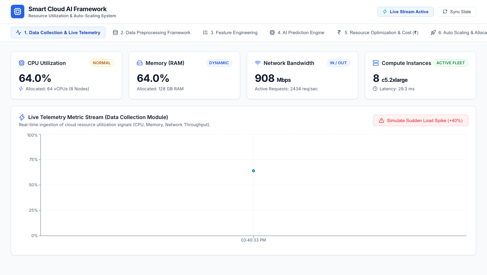
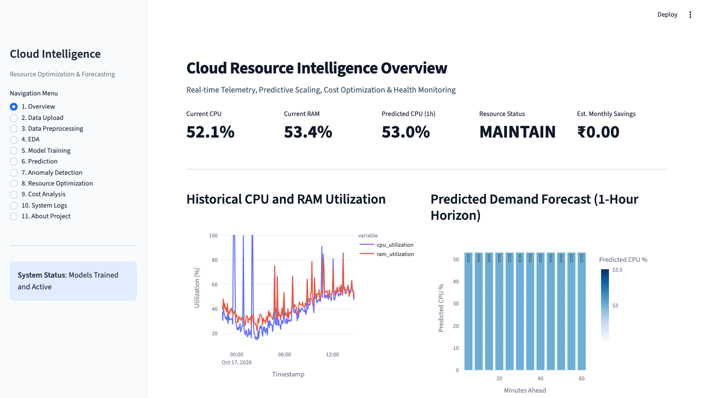

# AI-Powered Framework for Smart Cloud Resource Utilization

A comprehensive end-to-end machine learning framework designed to analyze historical cloud telemetry, forecast future resource demands, detect anomalous workload patterns, recommend cost-effective scaling strategies, and estimate operational infrastructure savings in Indian Rupees (INR).

---

## User Interfaces

### 1. React Web Application (Front Page)
The primary interactive user dashboard built with React and Vite. It provides live cloud telemetry streams, dynamic scaling decision controls, anomaly state visualization, and cost analysis in Indian Rupees (INR).



### 2. Streamlit Analytics Portal (http://localhost:8501/)
The academic analysis and research portal providing multi-model benchmarking (Random Forest, XGBoost, and PyTorch LSTM), dataset profiling, anomaly inspection, and autoscaling policy simulations.



---

## Project Overview

Modern cloud platforms often struggle with the balance between performance and cost. Over-provisioning leads to financial wastage, while under-provisioning leads to service degradation and SLA breaches. Static monitoring tools provide only reactive alerts once thresholds have already been crossed.

This project implements a proactive, predictive framework that analyzes workload metrics across multi-cloud environments (AWS CloudWatch, Google Cluster Trace, Alibaba Cluster Trace, or custom CSV telemetry) to anticipate demand before traffic surges occur.

---

## Core Capabilities

- Multi-Format Telemetry Ingestion: Ingests time-series workload datasets with automated column mapping and data hygiene checks.
- Preprocessing and Validation: Automated imputation for missing values, statistical outlier detection (IQR, Z-Score, Isolation Forest), feature scaling, and chronological windowing.
- Predictive Workload Modeling: Comparative evaluation of Random Forest, XGBoost, and PyTorch LSTM models on MAE, RMSE, R-squared, and MAPE metrics without time-series lookahead leakage.
- Anomaly Detection: Unsupervised Isolation Forest pipeline identifying CPU spikes, memory saturation, and irregular network throughput.
- Intelligent Scaling Engine: Rule-guided and AI-informed decision engine recommending Scale-Up, Maintain, or Scale-Down actions with configurable cooldown guardrails.
- Financial Cost Modeling: Estimates monthly cloud expenditures and potential savings in Indian Rupees (INR - Rs.) based on resource utilization.
- Dual User Interfaces: An 11-page Streamlit academic analytics portal alongside a modern React and Vite single-page application.
- Automation Integration: REST API webhooks compatible with workflow orchestration tools like n8n.

---

## System Architecture

```
Cloud Telemetry Data (Google Trace / Alibaba Trace / AWS / Custom CSV)
                                |
                      FastAPI Backend Engine
                                |
        +-----------------------+-----------------------+
        |                       |                       |
  Preprocessing           ML Forecasting         Isolation Forest
   & Imputation        (RF, XGBoost, LSTM)       Anomaly Detector
        +-----------------------+-----------------------+
                                |
                    Smart Optimization Engine
                                |
                     Cost & Scaling Decider
                                |
        +-----------------------+-----------------------+
        |                                               |
Streamlit Academic Portal                       React Vite Web Application
```

---

## Technology Stack

- Programming Language: Python 3.12, JavaScript (ES6+)
- Backend API: FastAPI, Uvicorn, Pydantic, SQLAlchemy
- Machine Learning & Analytics: Scikit-learn, XGBoost, PyTorch, Pandas, NumPy, SciPy, Joblib
- Frontend Dashboards: Streamlit, React, Vite, Lucide Icons, Chart.js / Plotly
- Database: SQLite (default), extensible to MySQL and PostgreSQL
- Containerization & CI: Docker, Docker Compose, Pytest

---

## Project Structure

```
.
|-- backend/
|   |-- main.py              # FastAPI application and endpoint definitions
|   |-- database.py          # SQLAlchemy database engine and session setup
|   |-- models_db.py         # Database schema definitions
|   |-- preprocessing.py     # Telemetry cleaning and feature engineering
|   |-- models.py            # Random Forest, XGBoost, and LSTM model engines
|   |-- anomaly.py           # Isolation Forest anomaly detection
|   |-- optimization.py      # Scaling recommendation logic and cooldown checks
|   |-- cost.py              # Cloud cost estimation in Indian Rupees (INR)
|   |-- autoscaler.py        # Autoscaling policy simulation
|   |-- data_generator.py    # Synthetic telemetry dataset generator
|   `-- notifications.py     # Webhook dispatcher for alert workflows
|-- frontend/                # React Vite single-page application
|   |-- src/
|   |   |-- App.jsx
|   |   |-- index.css
|   |   `-- components/
|   `-- package.json
|-- streamlit_app.py         # Multi-page Streamlit analytics dashboard
|-- data/
|   |-- sample/              # Sample benchmark telemetry datasets
|   |-- raw/
|   `-- processed/
|-- notebooks/               # Exploratory data analysis Jupyter notebooks
|-- tests/                   # Automated test suite (test_pipeline.py)
|-- docs/                    # Academic report and design specifications
|   `-- screenshots/         # Dashboard interface screenshots
|-- models/                  # Serialized model weight artifacts
|-- Dockerfile               # Container packaging file
|-- docker-compose.yml       # Multi-service container orchestration
|-- requirements.txt         # Python package dependencies
`-- README.md
```

---

## Setup and Installation

### 1. Prerequisites
- Python 3.10 or higher
- Node.js 18+ and npm (for the React web interface)
- Git

### 2. Clone the Repository
```bash
git clone https://github.com/Rishikesh2621/AI-Powered-Framework-for-Smart-Cloud-Resource-Utilization.git
cd AI-Powered-Framework-for-Smart-Cloud-Resource-Utilization
```

### 3. Python Environment Setup
```bash
# Create a virtual environment
python3 -m venv .venv

# Activate the virtual environment
# On macOS / Linux:
source .venv/bin/activate
# On Windows:
# .venv\Scripts\activate

# Install dependencies
pip install -r requirements.txt
```

### 4. Frontend Setup
```bash
cd frontend
npm install
cd ..
```

---

## Running the Services

### Option A: Running Locally

1. Start the FastAPI AI Engine:
   ```bash
   uvicorn backend.main:app --host 0.0.0.0 --port 8000 --reload
   ```
   Interactive OpenAPI documentation is available at `http://localhost:8000/docs`.

2. Start the Streamlit Analytics Portal:
   ```bash
   streamlit run streamlit_app.py --server.port 8501
   ```
   Access the dashboard at `http://localhost:8501`.

3. Start the React Web Interface:
   ```bash
   cd frontend
   npm run dev -- --port 5173
   ```
   Access the web interface at `http://localhost:5173`.

### Option B: Running with Docker Compose
```bash
docker-compose up --build -d
```

---

## API Endpoints Summary

| Method | Endpoint | Description |
| :--- | :--- | :--- |
| GET | `/health` | Health status of API and database |
| GET | `/api/metrics/live` | Current telemetry metrics stream |
| POST | `/api/upload-csv` | Telemetry dataset upload and column mapping |
| POST | `/api/preprocess/run` | Data cleaning and validation pipeline |
| POST | `/api/models/train` | Train Random Forest, XGBoost, and LSTM models |
| GET | `/api/models/evaluation` | Benchmark metrics (MAE, RMSE, R-squared, MAPE) |
| POST | `/api/models/predict` | Generate forward resource utilization forecasts |
| GET | `/api/anomalies` | Isolation Forest anomaly detection results |
| GET | `/api/recommendation` | Scaling recommendation with cooldown state |
| GET | `/api/cost-estimate` | Current vs optimized cloud expenditure (INR) |
| POST | `/api/notifications/n8n-trigger` | Webhook alert dispatch |

---

## Running Automated Tests

Run the test suite using pytest:
```bash
python -m pytest tests/test_pipeline.py -v
```

---

## Author
- Rishikesh Thakare (GitHub: [@Rishikesh2621](https://github.com/Rishikesh2621))
